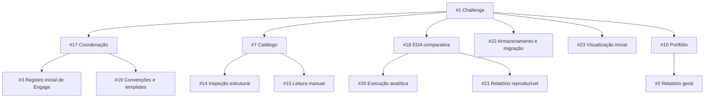

# Revisão da organização — 30/09/2026

## Diagnóstico

A estrutura exigia ajustes pontuais. O catálogo #7 e sua inspeção #14 já tinham escopos diferentes da EDA aprofundada #18; fundi-los apagaria essa distinção. A sequência metodológica #11 também é diferente da coordenação de marcos #17. As novas entregas reutilizam essas referências sem criar uma issue por gráfico, fonte ou operação pequena.

Não foi identificada duplicata literal que justificasse fechar uma issue nesta revisão. A #3 repete atividades de outras issues, mas funciona como registro inicial de Engage: seus itens passam a apontar para a execução canônica. Seus períodos divergentes do registro da #1 foram preservados como histórico pendente de validação. O relatório geral #2 é parte do portfólio #10; o relatório de EDA #21 fornece resultados especializados a ambos.

O principal risco de organização era atribuir a todas as issues abertas um mesmo nível de execução, misturar fase e tema e criar uma sequência rígida para atividades que podem avançar por recortes. Responsáveis, datas e status precisam refletir trabalho real. Não foram criadas dependências formais: as relações de entrada ainda permitem execução incremental e serão refinadas com requisitos concretos.

## Hierarquia

#5, #6, #8, #9, #11 e #12 continuam como frentes diretamente vinculadas à #1. A #11 fornece orientação metodológica, sem absorver todos os trabalhos relacionados como filhos. Pais representam composição de entregas; referências e entradas são registradas no texto.

## Ajustes e novas issues

| Issue | Papel e mudança |
| --- | --- |
| #3 | Preservar registro inicial, apontar execução canônica e retirar datas não validadas do título ativo |
| #5, #6, #8, #9, #10 | Acrescentar objetivo, entrega, aceite e relações às descrições iniciais curtas, preservando o texto original |
| #7, #14, #15 | Esclarecer limites e evolução incremental; primeiro uso da leitura manual não exige todos os filtros possíveis |
| #18 | Vincular ao Challenge, esclarecer escolha provisória do repositório e separar execução/síntese |
| #19 — nova | Registrar esta organização, templates e fluxo de contribuição; encerrar com evidência das convenções publicadas |
| #20 — nova | Executar EDA com perguntas explícitas, proveniência, denominadores e limites de comparabilidade |
| #21 — nova | Consolidar relatório e reprodução; contribuir ao relatório geral e portfólio |
| #22 — nova | Organizar dados locais e adaptar o acervo intermediário; banco/submodules permanecem decisões posteriores |
| #23 — nova | Delimitar e entregar visualização navegável; público, recorte e stack ainda serão refinados |

As novas #22 e #23 tornam explícitas duas entregas solicitadas que não estavam cobertas apenas por “fazer EDA”. A #19 registra o trabalho de organização já executado. Não foram abertas issues específicas de clustering, embeddings, treinamento, banco remoto ou fine-tuning sem pergunta e critério de avaliação definidos.

## Labels

O catálogo tinha 21 labels na retomada, incluindo `tema:eda`, criada na sessão anterior. Categorias existentes cobrem pesquisa, dados, documentação e planejamento. A lacuna imediata para filtrar a entrega navegável foi preenchida por `tema:visualizacao`.

| Problema | Ajuste |
| --- | --- |
| `fase:engage` aplicada a dados no milestone Investigate e a pais que atravessam fases | Retirar aplicações; marcar a descrição da label como legado e usar milestone para fase |
| `enhancement` na #9 coexistindo com tipo nativo Feature e categorias locais | Preservar Feature; usar `tipo:planejamento` para o trabalho de delimitação |
| `documentation` e `tipo:documentacao` com propósitos sobrepostos | Preferir a categoria local e preservar labels padrão sem uso, sem excluir vocabulário por antecipação |
| Inspeção mínima e EDA aprofundada sem filtro temático comum | Aplicar `tema:eda` à #14 e à frente #18/#20/#21, mantendo a distinção nos títulos/aceites |
| Expectativa de labels para prioridade, bloqueio ou responsável | Usar campos do Project, Assignees e dependências nativas quando a necessidade existir |

Os nomes `tipo:*` continuam por compatibilidade e são explicados como categorias; o tipo nativo descreve Task/Feature/Bug. Renomear todas as labels para `area:*` agora traria manutenção e quebra de filtros com pouco benefício imediato.

## Decisões e próximos refinamentos

O usuário confirmou EDA e visualização juntas provisoriamente e dados externos ao Git, seguindo a proposta de diretório central. A futura normalização/consolidação em banco local por desenvolvedor ou remoto precisa de planejamento próprio. Nenhuma migração de corpus foi feita nesta revisão.

As propostas Laya foram consolidadas em documento local da workspace e não publicadas. O clone agora possui remoto pessoal; destino organizacional e eventual hierarquia entre repositórios serão avaliados antes de criar suas issues.

Para a próxima conversa: selecionar perguntas/datasets da EDA, definir público e tarefa principal da visualização, revisar o marco histórico #3 e detalhar a arquitetura de dados somente a partir dos usos necessários. As alternativas de template e critérios para evoluir o fluxo Git estão em `CONTRIBUTING.md`.
